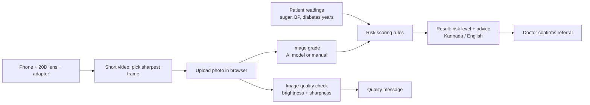

# DRishti: Technical Design Document

## 1. Overview

DRishti is a single-page website for screening diabetic retinopathy (DR). It combines a retina photo, three patient readings and an image grade into a risk level with referral advice in Kannada or English. All processing happens in the user's browser.

## 2. Architecture



Everything inside the browser box below runs on the user's device. No server, no database.

```
+------------------- Browser (index.html) -------------------+
|  Upload photo -> Quality check (canvas)                    |
|  Image grade  -> AI model (Teachable Machine) OR manual    |
|  Readings     -> Risk scoring rules                        |
|  Result       -> Kannada / English text -> Print           |
+-------------------------------------------------------------+
```

## 3. Components

| Component | What it does | Technology |
|---|---|---|
| Capture hardware | Takes the retina photo | Smartphone, 20D lens, adapter |
| Upload and preview | Reads the photo locally | HTML file input, object URL |
| Quality check | Flags dark, glare or blurry images | JavaScript canvas (brightness, Laplacian sharpness) |
| Image grade | No DR, Mild or Severe | Google Teachable Machine (TensorFlow.js) or manual selection |
| Risk scoring | Combines grade and readings | Plain JavaScript rules |
| Result and language | Shows risk, advice, reasons | Kannada and English text |

## 4. Risk scoring rules (demo)

| Input | Condition | Points |
|---|---|---|
| Image grade | No DR / Mild / Severe | 0 / 2 / 5 |
| Blood sugar (mg/dL) | 180 to 249 / 250 or more | 1 / 2 |
| Blood pressure (top number) | 140 or more | 1 |
| Years with diabetes | 5 to 9 / 10 or more | 1 / 2 |

**Risk level:** High if grade is Severe or total is 6 or more. Medium if total is 3 to 5. Otherwise Low.

| Level | Advice |
|---|---|
| Low | Eye check once a year |
| Medium | See an eye doctor within 3-6 months |
| High | See an eye specialist as soon as possible |

These rules are a simple demo for the hackathon. They are not clinically validated.

## 5. Image quality check

The photo is drawn on a 200-pixel-wide canvas. Mean brightness and the variance of a Laplacian filter (sharpness) are computed.

- Brightness below 35: too dark
- Brightness above 200: too bright or glare
- Sharpness below 30: possibly blurry

The thresholds are not calibrated and are only a hint to retake the photo.

## 6. Privacy and safety

- Photos and readings stay in the browser. Nothing is sent to a server.
- The result is a screening aid. A doctor confirms every referral.
- Pupil dilation and retina capture are done only by trained staff.

## 7. Limitations

- Needs a trained model for automatic grading. Demo mode uses a manual grade.
- Not validated on Indian clinical images.
- Capture quality depends on the adapter, lens and operator practice.

## 8. Future scope

- Train and validate the AI model on Indian clinic data
- Add a light sensor (BH1750) to check the room is dim enough for natural pupil widening
- Offline mode for areas without internet
- Doctor dashboard for referral follow-up
